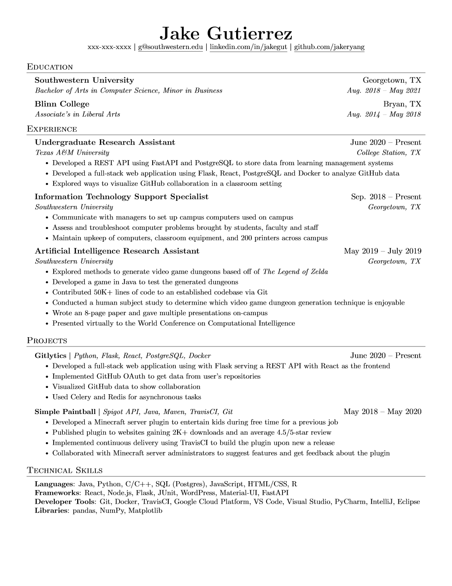

# resume

My personal resumes in LaTeX, based on the [Jake's Resume](https://www.overleaf.com/latex/templates/jakes-resume/syzfjbzwjncs) template ([sb2nov/resume](https://github.com/sb2nov/resume/)).

## Structure

| Path | Description |
|------|-------------|
| `base-form/resume.tex` | Pristine template with placeholder content — copy it to start a new variant |
| `eng/qa-automation/resume.tex` | QA Automation Engineer resume (English) |
| `ru/full/resume.tex` | Full resume (Russian) — Software Engineer, Internal Tools & AI |

New variants follow the `<language>/<position>/resume.tex` layout.

## Building

Requires a LaTeX distribution (e.g. TeX Live / MacTeX):

```sh
cd eng/qa-automation   # or ru/full, base-form
latexmk -pdf resume.tex
latexmk -c             # clean aux files
```

## Preview (base template)


